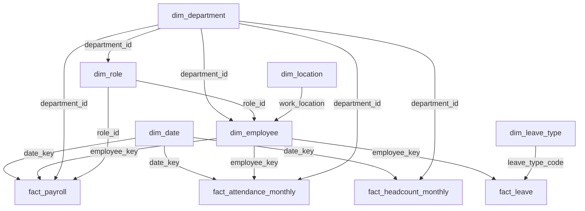

# PulseIQ Star Schema

## Dimension tables

- `dim_date` — Date and calendar attributes.
- `dim_employee` — Employee details and employment history.
- `dim_department` — Department details.
- `dim_role` — Role and grade details.
- `dim_location` — Work location details.
- `dim_leave_type` — Leave type and policy details.

## Fact tables and dimension relationships

## Validation summary

- All 6 dimension tables and 4 fact tables are loaded.
- Primary key uniqueness and null checks passed for all 10 tables.
- Employee orphan checks returned zero orphan records.
- All 14 additional dimension reference checks passed.
- Fact row counts reconcile with the ETL-cleaned Parquet files.
